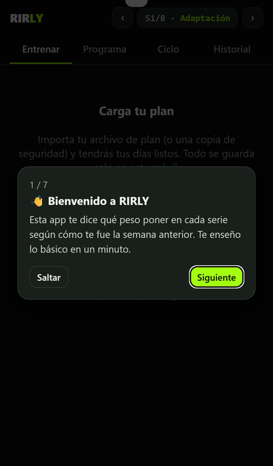
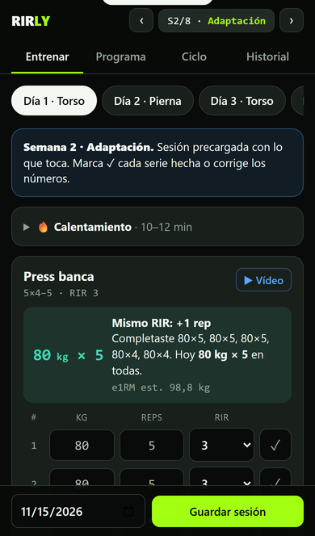
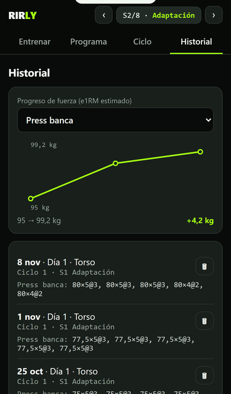
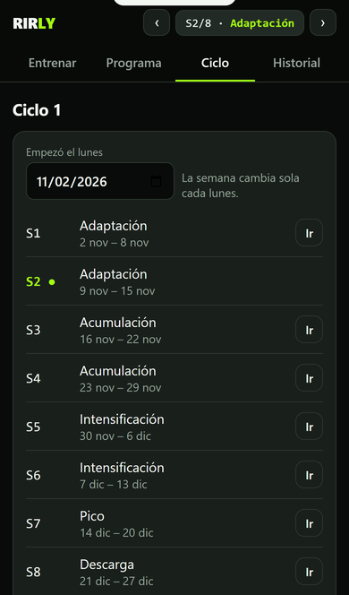

<p align="center"></p>

<h1 align="center">RIRLY</h1>

<p align="center">Registro de entrenamiento de fuerza que te dice qué peso poner en cada serie según el RIR.<br>
App web instalable para iPhone y Android: sin cuentas, sin servidor y funciona sin conexión.</p>

<p align="center">
  
  
  
  
</p>

## Qué hace
- **Calcula la carga de cada sesión** a partir de lo que hiciste la semana anterior: si te sobraron reps, sube; si costó, consolida.
- **Autorregulación en directo:** si una serie te sale con otro RIR, reajusta las series pendientes.
- **Ciclos a tu medida:** eliges cuántos ciclos y de cuántas semanas (2–16), con el RIR de cada semana. La semana se calcula sola cada lunes y la carga sube al empezar ciclo nuevo.
- **Tipos de ejercicio:** carga, lastre (suma el peso corporal), peso corporal, isometría y % de otro ejercicio (p. ej. banca de velocidad).
- **Historial** con gráficas de fuerza estimada (e1RM), peso máximo, volumen por ejercicio y volumen semanal.
- **Guía paso a paso** la primera vez que se abre.
- **Privada:** todo se guarda solo en el móvil. Las copias de seguridad son archivos que guardas tú.

**¿Qué es el RIR?** Repeticiones en recámara: cuántas reps más podrías haber hecho al acabar la serie. RIR 2 = te quedaban 2.

## Instalar en el móvil
1. Abre la dirección de la app:
   - **iPhone:** en **Safari** → Compartir → **Añadir a pantalla de inicio**.
   - **Android:** en **Chrome** → menú ⋮ → **Instalar aplicación**.
2. Ábrela desde el icono y sigue la guía.
3. **Entrenar → Importar archivo** con tu archivo de plan, o créalo a mano en **Programa**.

Se actualiza sola la próxima vez que se abre con conexión.

## Publicar
La carpeta [`rirly-ios/`](rirly-ios/) es la app completa: no hay compilación.

- **Netlify conectado al repo (recomendado):** en Netlify, *Add new site → Import an existing project* y elige este repositorio. [`netlify.toml`](netlify.toml) ya indica qué carpeta publicar. Cada `git push` publica la versión nueva.
- **A mano:** arrastra la carpeta `rirly-ios` a https://app.netlify.com/drop (o a *Deploys* de tu sitio para mantener la misma dirección).

Funciona en cualquier hosting estático con HTTPS. Las cabeceras de seguridad de [`rirly-ios/_headers`](rirly-ios/_headers) son de Netlify; en otro hosting habría que configurarlas allí.

> ⚠️ Los datos de cada persona se guardan **por dirección web**. Si cambias la app de dirección, exporta una copia (Ciclo › Exportar a archivo) e impórtala en la nueva.

## Planes y copias de seguridad
| Archivo | Al importarlo |
|---|---|
| **Plan** (`"kind": "plan"`) | Sustituye el programa. Conserva historial, ciclo, semana actual, peso corporal y la sesión en curso |
| **Copia de seguridad** (Ciclo › Exportar) | Sustituye todo (programa e historial). Pide confirmación |

> 🔒 **No subas nunca planes personales ni copias de seguridad al repo ni al hosting.** El [`.gitignore`](.gitignore) ignora todos los `.json` salvo el plan de ejemplo.

[`tests/plan-ejemplo.json`](tests/plan-ejemplo.json) es una plantilla de 5 días sin datos personales. Formato de un plan:

```jsonc
{
  "app": "rirly",
  "kind": "plan",
  "cfg": {
    "v": 3,
    "rules": "Tus normas (texto libre)",
    "days": [
      {
        "id": "dia1",                 // letras, números, _ o -
        "name": "Día 1 · Torso",
        "type": "torso",              // torso | pierna | pecho | espalda | hombro | biceps | triceps | antebrazo | core | cuadriceps | femoral | gluteo | gemelo (tren inferior sube 5 kg por ciclo, el resto 2,5)
        "exercises": [
          {
            "id": "banca",
            "name": "Press banca",
            "sets": 5, "repsMin": 4, "repsMax": 5,
            "inc": 2.5,               // salto de peso: 0.5 | 1 | 1.25 | 2 | 2.5 | 5
            "seq": "3·3·2·2·2·1·1·D", // RIR de S1 a S8 (0–5); D = descarga
            "kind": "load",           // load | bwadd (lastre) | bw (corporal) | iso | pct
            "ref": "banca",           // solo pct: id del ejercicio de referencia
            "ss": "A",                // opcional: superserie
            "link": "https://…",      // opcional: vídeo (vacío = búsqueda en YouTube)
            "notes": ""
          }
        ]
      }
    ]
  }
}
```

## Estructura
```
rirly-ios/              la app (lo que se publica)
  index.html            página, sin código ni estilos en línea
  styles.css            estilos; paleta RIRLY al principio (--bg, --card, --tx, --mut, --up)
  js/util.js            utilidades: DOM, fechas, números, escape de HTML
  js/datos.js           constantes, estado, saneado de datos importados, almacenamiento
  js/motor.js           semanas del ciclo, motor de cargas, autorregulación, borradores
  js/vistas.js          HTML de cada pestaña
  js/guia.js            guía de primera vez (textos en GUIDES)
  js/app.js             eventos, importar/exportar, arranque
  sw.js                 modo sin conexión (si cambias la lista de archivos, sube CACHE)
  _headers              cabeceras de seguridad (Netlify)
  manifest.webmanifest  nombre, colores e iconos al instalarla
assets/logo-rirly.png   logo original (de él salen los iconos)
docs/                   capturas del README
tests/                  tests end-to-end y plan de ejemplo
```
Los scripts se cargan en ese orden y comparten ámbito global (sin módulos ni compilación). Iconos: `icon-192/512.png` (normal), `apple-touch-icon.png` (iPhone, solo el logo porque iOS recorta su propia forma) e `icon-maskable-512.png` (Android, logo dentro de la zona segura).

## Desarrollo
Ver la app en local (el service worker funciona en `localhost`):
```
cd rirly-ios
python -m http.server 8080
```
Abre http://localhost:8080 y, para verla como en un móvil, `F12` → `Ctrl+Shift+M`.

### Tests
58 tests end-to-end con Playwright (Chrome en modo iPhone 13): motor de cargas, fechas y cambio de hora, archivos maliciosos (XSS, ids trampa), archivos sin versión, carga de plan sin perder el ciclo, exportar/restaurar, almacenamiento lleno, formulario de Programa, guía de primera vez, diseño móvil, modo sin conexión, cero peticiones externas, cero violaciones de CSP y cero errores de JavaScript.

```
pip install -r requirements-dev.txt
python -m playwright install chromium
python -I tests/test_rirly.py
```
Se ejecutan también en cada push con GitHub Actions ([`.github/workflows/tests.yml`](.github/workflows/tests.yml)). Por defecto usan `rirly-ios` y `tests/plan-ejemplo.json`; con otro plan: `python -I tests/test_rirly.py rirly-ios ruta/al/plan.json` (espera 5 días con la estructura del ejemplo). `CHROME_PATH` permite usar otro navegador.

## Seguridad
| Riesgo | Protección |
|---|---|
| XSS por archivo importado manipulado | Todo lo importado se valida y normaliza (tipos, longitudes, rangos) y se escapa al pintar |
| Ids trampa (`__proto__`, `constructor`, `toString`…) | Se descartan |
| Enlaces `javascript:` / `data:` | Solo `http(s)` |
| Scripts o estilos inyectados | CSP estricta: `script-src 'self'`, `style-src 'self'`, sin conexiones externas |
| Clickjacking / fugas de referrer | `frame-ancestors 'none'`, `nosniff`, `no-referrer`, `Permissions-Policy`, `noindex` |
| Imports que borran datos | Confirmación previa; cargar un plan conserva historial y ciclo |
| Service worker | Solo guarda respuestas válidas del propio dominio, y solo la app como página sin conexión |

Sin dependencias en la app: no hay paquetes de terceros. Los datos están en el almacenamiento del navegador sin cifrar: cualquiera con el móvil desbloqueado podría verlos.
